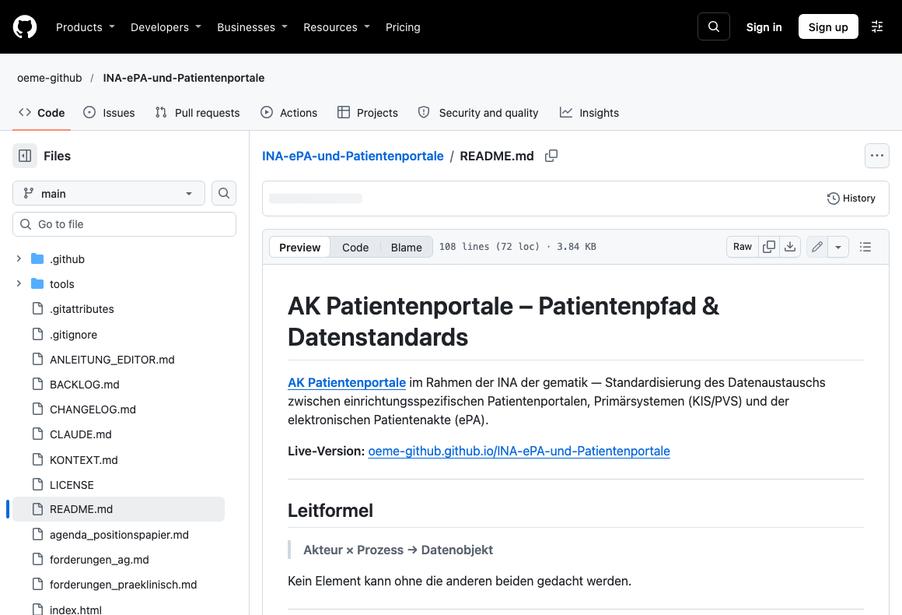

<a href="https://timofrank.github.io/ambulante-prozesskarte/">
  <picture>
    <source media="(max-width: 640px)" srcset="vorschau/patientenpfad-mobil.png">
    
  </picture>
</a>

Was passiert zwischen der Blutabnahme und dem Anruf mit dem Ergebnis? Wie geht es nach einer Überweisung oder einer ambulanten Operation weiter? Die [interaktive Karte](https://timofrank.github.io/ambulante-prozesskarte/) zeigt, wer den nächsten Schritt übernimmt und welche Informationen dafür gebraucht werden.

## Einblick in die Karte

Ein Folgerezept braucht andere Schritte als eine ambulante Operation. Öffne eine Karte, um zu sehen, wer beteiligt ist und was als Nächstes passiert. Unter der Beschreibung findest du die Quellen zum Weiterlesen. [Beispiel Labor öffnen](https://timofrank.github.io/ambulante-prozesskarte/?suche=Labor)

## Herkunft und Einordnung

Das Vorbild ist die Krankenhauskarte des Arbeitskreises Patientenportale. Sie beschreibt den Weg vor, während und nach einem Krankenhausaufenthalt. Dafür hat der Arbeitskreis aus über 80 möglichen Schritten 25 ausgewählt. Wie die Auswahl zustande kam, erläutert er im [Positionspapier, Abschnitt 3.3](https://www.ina.gematik.de/fileadmin/Arbeitskreisdokumente/Patientenportale/Positionspapier.pdf#page=25).

[Original-Repository auf GitHub](https://github.com/oeme-github/INA-ePA-und-Patientenportale) oder [stationäre Prozesskarte öffnen](https://oeme-github.github.io/INA-ePA-und-Patientenportale/patientenpfad_interaktiv.html)

## #Mitmachen bei der gematik

Was funktioniert im Praxisalltag, und wo hakt es? Bei #Mitmachen können Praxisteams ihre Erfahrungen in Befragungen teilen oder die gematik zu einer Hospitation einladen. [Bei der gematik mitmachen](https://www.gematik.de/mitmachen)

## Offline öffnen

[Projekt als ZIP herunterladen](https://github.com/TimoFrank/ambulante-prozesskarte/archive/refs/heads/main.zip), entpacken und `index.html` im Browser öffnen.
