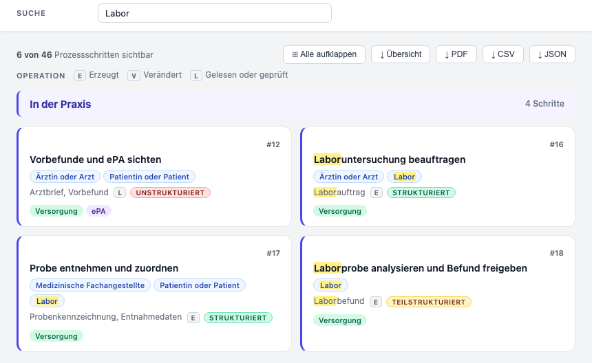

<a href="https://timofrank.github.io/ambulante-prozesskarte/">
  <picture>
    <source media="(max-width: 640px)" srcset="vorschau/patientenpfad-mobil.png">
    
  </picture>
</a>

  <a href="https://timofrank.github.io/ambulante-prozesskarte/"><strong>Interaktive Karte öffnen</strong></a>
  &nbsp; | &nbsp;
  <a href="https://timofrank.github.io/ambulante-prozesskarte/?ansicht=matrix">Zur Datenraum-Matrix</a>

Wo entsteht ein Laborauftrag? Wie kommt der Befund zurück in die Praxis? Wer kümmert sich nach einer ambulanten Operation um die Nachsorge? Die Karte macht an 46 Schritten sichtbar, wer beteiligt ist, welche Informationen entstehen und wer sie für die Weiterbehandlung braucht.

Eine Arbeitsfassung von **Timo Frank** aus dem Projekt **Versorgungsprozesse** im Rahmen seiner Arbeit bei der **gematik**. Stand der fachlichen Inhalte ist der 19. November 2026.

## Einblick in die Karte

Wer eine Karte öffnet, sieht den Ablauf, die beteiligten Rollen und die Fachquellen. Drei Einstiege zum Ausprobieren:

| Thema | Auf der Karte |
| --- | --- |
| [Labor](https://timofrank.github.io/ambulante-prozesskarte/?suche=Labor) | Von der Anforderung und der Probenentnahme bis zur ärztlichen Beurteilung des Befunds. |
| [Quartalswechsel](https://timofrank.github.io/ambulante-prozesskarte/?suche=Quartal) | Wann die Praxis die Gesundheitskarte einliest und wie lange ein Überweisungsauftrag gilt. |
| [Ambulante Operation](https://timofrank.github.io/ambulante-prozesskarte/?suche=ambulante%20Operationen) | Von der Entscheidung über den Eingriff bis zur Wundkontrolle. |

Die [Matrix](https://timofrank.github.io/ambulante-prozesskarte/?ansicht=matrix) zeigt, welche Praxisinformationen im Portal, in der Versorgung, in der elektronischen Patientenakte oder bei Krankenkasse und Kassenärztlicher Vereinigung eine Rolle spielen. Ein Schritt kann in mehreren Spalten vorkommen.

## Herkunft und Einordnung

Die ambulante Auswahl ist eine redaktionelle Arbeitsfassung für die vertragsärztliche Versorgung in Deutschland. Je nach Anliegen kommen einzelne Schritte hinzu, entfallen oder wiederholen sich. Die fachlichen Belege sind an den jeweiligen Karten verlinkt.

Aufbau und Bedienung stammen von der Krankenhauskarte des Arbeitskreises Patientenportale. Der Arbeitskreis wählte aus über 80 möglichen Schritten 25 für seinen Patientenpfad aus. Drei Unterarbeitsgruppen untersuchten zwölf davon vertieft. [Originalkarte](https://oeme-github.github.io/INA-ePA-und-Patientenportale/patientenpfad_interaktiv.html) und [Positionspapier, Abschnitt 3.3](https://www.ina.gematik.de/fileadmin/Arbeitskreisdokumente/Patientenportale/Positionspapier.pdf#page=25).

Mehr zur Zusammenarbeit der gematik mit der Versorgungspraxis gibt es bei [#Mitmachen](https://www.gematik.de/mitmachen).

## Offline nutzen und bearbeiten

Die [Projektdateien als ZIP herunterladen](https://github.com/TimoFrank/ambulante-prozesskarte/archive/refs/heads/main.zip), entpacken und `index.html` im Browser öffnen. Die Karte funktioniert auch offline. Die verlinkten Fachquellen sind online erreichbar.

* [index.html](index.html) enthält die Oberfläche, die Filter, die Matrix und die Exportfunktionen.
* [karten.js](karten.js) enthält die Prozessschritte und die zugehörigen Fachquellen.
* [LICENSE](LICENSE) enthält die Lizenz des übernommenen Viewers.

GitHub Pages veröffentlicht die Karte aus dem Hauptordner des Branches `main`.
