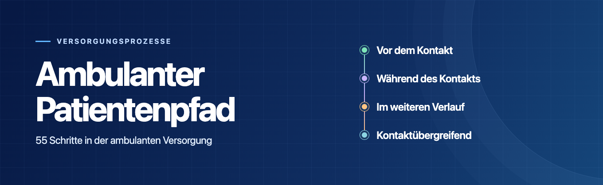

<picture>
  <source media="(max-width: 640px)" srcset="vorschau/patientenpfad-mobil-titelbild.png">
  
</picture>

<h2 align="center"><a href="https://timofrank.github.io/ambulante-prozesskarte/">Interaktive Karte öffnen ↗</a></h2>

Ambulante Versorgung beginnt oft schon mit dem ersten Anruf. Vor dem Praxisbesuch klären Patientinnen und Patienten mit dem Praxisteam, wie dringend ihr Anliegen ist und was sie zum Termin mitbringen sollen. In der Praxis folgen je nach Bedarf Beratung, Untersuchung oder Behandlung. Auch nach dem Besuch geht die Versorgung weiter, etwa wenn die Hausarztpraxis einen Befund mit der Patientin bespricht oder mit einer Facharztpraxis die Weiterbehandlung abstimmt.

Die Prozesskarte führt 55 ausgewählte Versorgungsschritte in einer Übersicht zusammen. Sie zeigt, wer welche Aufgabe übernimmt, wo Informationen entstehen und wer sie als Nächstes braucht. So lassen sich Abläufe vergleichen und Übergaben erkennen, an denen Praxen, Labore oder Apotheken aufeinander angewiesen sind.

## Einblick in die Karte

## So erkundest du die Karte

Wähle eine Phase, wenn dich ein bestimmter Abschnitt rund um den Behandlungskontakt interessiert. „Kontaktübergreifend“ zeigt Abläufe, die mehrere Kontakte verbinden. Du kannst auch über alle Phasen hinweg nach einem Thema suchen. Ein Klick auf einen Treffer zeigt dir, was in diesem Schritt passiert, wer beteiligt ist und wo du mehr darüber nachlesen kannst.

* Mit „Folgerezept“ findest du heraus, wie du ein Rezept für ein regelmäßig eingenommenes Medikament erneut anfragen kannst und was die Praxis vor dem Ausstellen prüft.
* Suche nach „Labor“ und folge einer Probe vom Untersuchungsauftrag über die Entnahme bis zu dem Moment, in dem die Ärztin oder der Arzt den Befund beurteilt.
* „eGK“ führt dich zum Versicherungsnachweis. Dort liest du, wann die Praxis die elektronische Gesundheitskarte einliest und wie eine Ersatzbescheinigung helfen kann, wenn die Karte fehlt.
* Für Formulare eignet sich der Suchbegriff „Muster“. Mit „Muster 6“ findest du Schritte rund um die Überweisung, mit „Muster 10“ den Laborauftrag.

Über den Filter für Fachpfade gelangst du direkt zur [Psychotherapie](https://timofrank.github.io/ambulante-prozesskarte/?fachpfad=Psychotherapie), zur [Privatbehandlung](https://timofrank.github.io/ambulante-prozesskarte/?fachpfad=Privatbehandlung) oder zur [Pathologie](https://timofrank.github.io/ambulante-prozesskarte/?fachpfad=Pathologie). Der Prozessbereich beschreibt die Tätigkeit, die Informationsdomäne den Inhalt. Bei der Privatabrechnung kannst du so unterscheiden, wo die Praxis einzelne Gebührenpositionen erfasst und in welcher Form die Rechnung bei der zahlungspflichtigen Person ankommt.

## Herkunft und Einordnung

Vorbild für die Darstellung ist die [stationäre Prozesskarte des Arbeitskreises Patientenportale](https://oeme-github.github.io/INA-ePA-und-Patientenportale/patientenpfad_interaktiv.html). Sie folgt dem Weg von der Vorbereitung auf einen Krankenhausaufenthalt über die Behandlung bis in die Zeit nach der Entlassung. Wie der Arbeitskreis aus über 80 möglichen Schritten 25 für diesen Weg ausgewählt hat, erläutert er in seinem [Positionspapier](https://www.ina.gematik.de/fileadmin/Arbeitskreisdokumente/Patientenportale/Positionspapier.pdf#page=25). Die zugehörigen Prozessdaten und den Aufbau der interaktiven Karte dokumentiert er im [Original-Repository auf GitHub](https://github.com/oeme-github/INA-ePA-und-Patientenportale).

## #Mitmachen bei der gematik

Was funktioniert im Praxisalltag, und wo hakt es? Bei #Mitmachen können Praxisteams ihre Erfahrungen in Befragungen teilen oder die gematik zu einer Hospitation einladen. [Bei der gematik mitmachen](https://www.gematik.de/mitmachen)

## Offline öffnen

[Projekt als ZIP herunterladen](https://github.com/TimoFrank/ambulante-prozesskarte/archive/refs/heads/main.zip), entpacken und `index.html` im Browser öffnen.
